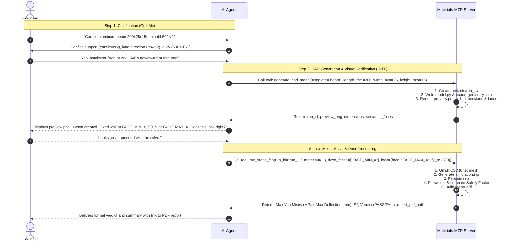

# MCP Intent & Agent-Server Communication Protocol

## 1. Purpose & Scope
This document specifies the exact communication protocol, interaction lifecycle, and data contracts between an **External AI Agent Harness** (e.g., Claude Desktop, Cursor, Gemini, GPT) and the **Materials-MCP Server**.

Its goal is to eliminate LLM hallucination and simulation errors by replacing monolithic "black-box" execution with a **Staged, Human-in-the-Loop (HITL) CAD and FEA verification workflow**.

---

## 2. The Core Separation of Responsibilities

```
┌─────────────────────────────────────────────────────────────┐
│                    User / Field Engineer                    │
└──────────────────────────────┬──────────────────────────────┘
                               │ (Plain English Request)
                               ▼
┌─────────────────────────────────────────────────────────────┐
│               External AI Agent (Reasoning)                 │
│  ├─ Gathers requirements & grills boundary conditions       │
│  ├─ Researches/validates material properties (E, ν, Yield)  │
│  ├─ Selects template & formulates structured tool parameters│
│  └─ Presents CAD visual preview & FEA report to the user    │
└───────────────┬─────────────────────────────▲───────────────┘
                │                             │
    JSON-RPC    │ Tool Requests               │ Tool Responses
    Over HTTP   │ (Stage 1: CAD Preview)      │ (Run ID, Preview PNG,
    (Port 8000) │ (Stage 2: Solve & Report)   │  Stress, SF, PDF Path)
                │                             │
                ▼                             │
┌─────────────────────────────────────────────────────────────┐
│             Materials-MCP Server (Computation)              │
│  ├─ 1. Run Directory Isolation (artifacts/run_.../)         │
│  ├─ 2. Parametric CAD Scripting & STEP Export (build123d)   │
│  ├─ 3. Headless 3D Visualization (Offscreen preview.png)    │
│  ├─ 4. Finite Element Meshing (gmsh second-order C3D10)     │
│  ├─ 5. Solver Execution (CalculiX ccx CLI)                  │
│  └─ 6. Results Extraction, Safety Factors & PDF Reporting   │
└─────────────────────────────────────────────────────────────┘
```

### Strict System Boundaries:
* **The Agent NEVER writes Gmsh or CalculiX `.inp` code directly.** The agent only supplies structured high-level parameters to deterministic tools.
* **The Server NEVER searches the web or manages API keys.** It operates 100% offline, executing deterministic geometry, meshing, and physics.
* **Code (`src/`) and Runs (`artifacts/`) are strictly separated.** User files and simulation data never enter `src/`.

---

## 3. Storage & Run Isolation Contract

Every agent interaction that generates geometry or solves a simulation creates an isolated, timestamped run directory.

### Directory Structure:
```
Materials-MCP/
├── src/                          <-- ENGINE CODE ONLY (Static, version-controlled)
│   ├── paths.py
│   ├── cad/
│   ├── preview/
│   ├── meshing/
│   ├── deck/
│   ├── solver/
│   ├── results/
│   └── server.py
│
└── artifacts/                    <-- SIMULATION DATA & AUDIT TRAILS ONLY
    ├── latest -> run_20261024_120000/
    │
    ├── run_20261024_085009/      (Beam A: 100% self-contained audit package)
    │   ├── model.py              <-- The exact build123d script generated
    │   ├── geometry.step         <-- 3D CAD STEP file
    │   ├── preview.png           <-- Headless 3D isometric screenshot
    │   ├── metadata.json         <-- Dimensions, volume, semantic face IDs
    │   ├── mesh.msh              <-- Gmsh finite element mesh
    │   ├── simulation.inp        <-- CalculiX input deck
    │   ├── simulation.dat        <-- Solver text results
    │   ├── simulation.frd        <-- Solver nodal field binary results
    │   └── report.pdf            <-- Formal engineering PDF report
    │
    └── users/                    <-- Multi-User Scaling Path
        ├── {user_id}/runs/run_20261025_090000/
        └── {user_id}/runs/run_20261025_101500/
```

### The JSON-to-Script Execution Invariant:
When the server receives a tool request with parameters (e.g., diameter, length, force):
1. **`src/` is NEVER touched or modified.**
2. A new folder `artifacts/run_YYYYMMDD_HHMMSS/` is provisioned.
3. The server writes a standalone, readable Python script (`model.py`) directly into that run folder.
4. The server executes `model.py` locally inside that run folder using subprocess (`cwd=run_dir`).
5. This guarantees that every run is 100% self-contained, auditable, and manually debuggable by typing `python model.py` in the terminal.

---

## 4. The 2-Stage Interaction Lifecycle

To prevent "Garbage In, Solved Garbage Out", the agent follows this sequence:



---

## 5. Tool Specifications & Data Schemas

### Context Window Protection (Progressive Disclosure)
To prevent 50+ geometric templates from exhausting the LLM's context window with schema bloat, the server implements **Progressive Disclosure**:
1. The server exposes a compact **Catalog Search Tool** (`list_geometry_templates`) requiring negligible tokens.
2. The agent fetches the exact parameter schema **on-demand** for only the chosen template (`get_template_schema`).
3. The agent calls `generate_cad_model` with clean parameters.

```
[Agent] ──(1. list_geometry_templates)──> [Server: returns 5-line match]
[Agent] ──(2. get_template_schema)───────> [Server: returns schema for chosen template only]
[Agent] ──(3. generate_cad_model)────────> [Server: creates run_.../model.py & preview.png]
```

---

### Tool 0A: `list_geometry_templates`
Lightweight catalog discovery. Returns matching template names, categories, and one-line summaries.

#### Request Schema:
```json
{
  "category": "structural",
  "query": "beam"
}
```

#### Response Schema:
```json
{
  "templates": [
    {"id": "beam_rectangular", "category": "structural", "description": "Solid rectangular beam (box)"},
    {"id": "beam_i_profile", "category": "structural", "description": "Standard I-beam / universal beam"},
    {"id": "bracket_l", "category": "mounting", "description": "L-shaped angle bracket with mounting holes"}
  ]
}
```

---

### Tool 0B: `get_template_schema`
Fetches parameter definitions, bounds, units, and semantic face descriptions for a single selected template.

#### Request Schema:
```json
{
  "template_id": "beam_rectangular"
}
```

#### Response Schema:
```json
{
  "template_id": "beam_rectangular",
  "description": "Solid rectangular prism with longitudinal X-axis",
  "parameters": {
    "length_mm": {"type": "number", "description": "Length along X axis (mm)", "default": 200.0, "min": 1.0},
    "width_mm": {"type": "number", "description": "Width along Y axis (mm)", "default": 25.0, "min": 1.0},
    "height_mm": {"type": "number", "description": "Height along Z axis (mm)", "default": 15.0, "min": 1.0}
  },
  "semantic_faces": ["FACE_MIN_X (left)", "FACE_MAX_X (right)", "FACE_MIN_Y (bottom)", "FACE_MAX_Y (top)", "FACE_MIN_Z (back)", "FACE_MAX_Z (front)"]
}
```

---

### Tool 1: `generate_cad_model`
Creates the parametric 3D model, saves `model.py` and `geometry.step`, renders `preview.png`, and indexes semantic faces.

#### Request Schema:
```json
{
  "template": "beam_rectangular",
  "parameters": {
    "length_mm": 200.0,
    "width_mm": 25.0,
    "height_mm": 15.0
  },
  "custom_script": null,
  "user_id": "default_user"
}
```
* `template` (string, required if `custom_script` is null): ID of geometric template (e.g., `"beam_rectangular"`).
* `parameters` (object, required for template): Key-value dimension pairs conforming to `get_template_schema`.
* `custom_script` (string, optional): Full Python script using `build123d` for freeform geometry.
* `user_id` (string, optional): User or session identifier for multi-user isolation.

#### Response Schema:
```json
{
  "run_id": "run_20261024_120000",
  "status": "SUCCESS",
  "artifacts": {
    "step_file": "/workspace/artifacts/run_20261024_120000/geometry.step",
    "preview_image": "/workspace/artifacts/run_20261024_120000/preview.png",
    "script_file": "/workspace/artifacts/run_20261024_120000/model.py",
    "metadata_file": "/workspace/artifacts/run_20261024_120000/metadata.json"
  },
  "geometry_summary": {
    "bounding_box_mm": {"x": 200.0, "y": 25.0, "z": 15.0},
    "volume_mm3": 75000.0
  },
  "semantic_faces": [
    {
      "face_id": "FACE_MIN_X",
      "normal": [-1.0, 0.0, 0.0],
      "center_mm": [-100.0, 0.0, 0.0],
      "area_mm2": 375.0,
      "description": "Left end face (X = -100mm)"
    },
    {
      "face_id": "FACE_MAX_X",
      "normal": [1.0, 0.0, 0.0],
      "center_mm": [100.0, 0.0, 0.0],
      "area_mm2": 375.0,
      "description": "Right end face (X = +100mm)"
    }
  ],
  "agent_instructions": "Display preview_image to the user. Confirm the boundary conditions with the user using the semantic face IDs before calling run_static_fea."
}
```

---

### Tool 2: `run_static_fea`
Meshes the existing CAD model, constructs the CalculiX input deck, runs `ccx`, evaluates safety factors, and generates the PDF report.

#### Request Schema:
```json
{
  "run_id": "run_20261024_120000",
  "material": {
    "name": "6061-T6 Aluminum",
    "elastic_modulus_mpa": 68900.0,
    "poisson_ratio": 0.33,
    "yield_strength_mpa": 276.0,
    "density_kg_m3": 2700.0
  },
  "boundary_conditions": {
    "fixed_faces": ["FACE_MIN_X"]
  },
  "loads": [
    {
      "face_id": "FACE_MAX_X",
      "force_vector_n": [0.0, -500.0, 0.0]
    }
  ],
  "mesh_size_mm": 3.0,
  "safety_factor_target": 2.0
}
```

#### Response Schema:
```json
{
  "run_id": "run_20261024_120000",
  "status": "SUCCESS",
  "verdict": "PASS",
  "safety_factor": 3.45,
  "safety_factor_target": 2.0,
  "results": {
    "max_von_mises_mpa": 80.0,
    "max_displacement_mm": 1.12,
    "yield_strength_mpa": 276.0,
    "mesh_node_count": 4820,
    "mesh_element_count": 2950,
    "element_type": "C3D10"
  },
  "artifacts": {
    "report_pdf": "/workspace/artifacts/run_20261024_120000/report.pdf",
    "solver_deck": "/workspace/artifacts/run_20261024_120000/simulation.inp",
    "solver_dat": "/workspace/artifacts/run_20261024_120000/simulation.dat",
    "solver_frd": "/workspace/artifacts/run_20261024_120000/simulation.frd"
  },
  "summary": "Beam comfortably meets the structural target with a Safety Factor of 3.45 (Target: 2.00). Max Von Mises stress is 80.00 MPa (Yield: 276.00 MPa). Full engineering report generated."
}
```

---

### Tool 3: `run_quick_beam_analysis` (Convenience Macro)
For standard rectangular cantilever beams where the user wants an instant sanity check without multi-turn CAD inspection.

#### Request Schema:
```json
{
  "length_mm": 200.0,
  "width_mm": 25.0,
  "height_mm": 15.0,
  "load_n": 500.0,
  "load_direction": "transverse_down",
  "material_name": "6061-T6",
  "e_gpa": 68.9,
  "nu": 0.33,
  "yield_strength_mpa": 276.0,
  "safety_factor_target": 2.0
}
```
*Internally executes Stage 1 + Stage 2 sequentially and returns the complete results package in a single turn.*

---

## 6. MCP Prompts: Guiding the Agent (The "Grill-Me" Skill)

The server exposes standard MCP prompts that AI harnesses can activate to enforce rigorous engineering dialogue:

### Prompt: `fea_requirements_interview`
* **Trigger**: Whenever the user asks for structural analysis, stress checks, or load-bearing calculations.
* **Prompt Instructions to Agent**:
  > 1. Do not guess boundary conditions. Confirm the support type (cantilever, simple support, fixed-fixed).
  > 2. Verify load application (point load at tip, distributed pressure, axial tension).
  > 3. Verify material properties: Young's Modulus ($E$), Poisson's ratio ($\nu$), and Yield Strength ($\sigma_y$).
  > 4. Call `generate_cad_model` first.
  > 5. Present `preview.png` to the user and confirm the face selection before calling `run_static_fea`.

---

## 7. Error Handling & Protocol Resilience

Every tool response includes standard machine-parseable status and error codes:

| Error Code | Cause | Agent Action |
| :--- | :--- | :--- |
| `CAD_GEOMETRY_ERROR` | `build123d` failed (invalid dimensions, non-manifold geometry). | Inspect error message, adjust dimensions, and retry CAD generation. |
| `PREVIEW_RENDER_ERROR` | Offscreen visualizer failed to render `preview.png`. | Fallback to returning bounding box metadata; inform user. |
| `MESH_GENERATION_ERROR` | Gmsh failed to generate 3D tetrahedrons (element sizing too small/large). | Increase mesh size parameter or refine geometry. |
| `SOLVER_DIVERGENCE` | CalculiX `ccx` exited with non-zero status or unconstrained degrees of freedom. | Verify that at least one face has fixed boundary conditions (`rigid body motion prevented`). |
| `FILE_NOT_FOUND` | Specified `run_id` does not exist or has expired. | Re-run CAD generation stage to acquire a new `run_id`. |

---

## 8. Technical Transport & Host Requirements

* **Protocol**: Model Context Protocol (MCP) JSON-RPC 2.0 over Streamable HTTP (SSE).
* **Port**: `8000` (`/mcp` endpoint).
* **Environment**: Containerized Linux (arm64 and amd64).
* **Engine Runtimes**:
  * Python 3.10+ (`build123d`, `gmsh`, `matplotlib` Agg, `reportlab`)
  * CalculiX `ccx` 2.17+ CLI binary
  * Gmsh 4.8+ CLI and Python C-bindings
  * Pure headless operation (zero X11/OpenGL display dependencies).
